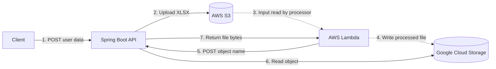

# Spreadsheet Cloud API

Spring Boot service with two REST endpoints that bracket a cross-cloud data pipeline:

1. **Create:** a client posts user data; the API builds an XLSX spreadsheet and uploads it to AWS S3.
2. **Download:** after AWS Lambda has processed that spreadsheet and written the result to Google Cloud Storage (GCS), Lambda calls this API to download the processed file.



> This repository contains the API only. The Lambda function and its S3 trigger are external (the dotted arrows) and must be deployed separately.

## Documentation

| Document | Level | Answers |
|---|---|---|
| This README | Usage | How do I configure, run, test, and call the API? |
| [docs/ARCHITECTURE.md](docs/ARCHITECTURE.md) | HLD | What are the system's parts, boundaries, and major decisions? |
| [docs/DESIGN.md](docs/DESIGN.md) | LLD | How does each class work, step by step? |
| JavaDoc (`mvn javadoc:javadoc`) | Code | What does each class and method guarantee? Output: `target/site/apidocs`. |

## Requirements

- Java 17 or later
- Maven 3.9 or later
- For real cloud use: AWS credentials that can write to the S3 bucket, and Google Cloud Application Default Credentials (ADC) that can read the GCS bucket
- For local use: Podman or Docker, to run the emulators described below

The AWS SDK uses its default credential provider chain and the Google Cloud client uses ADC. Grant only the permissions listed in [Architecture](docs/ARCHITECTURE.md#security), and never commit credentials.

## Configuration

| Environment variable | Required | Default | Purpose |
|---|---:|---|---|
| `AWS_S3_BUCKET` | Yes | none | Destination bucket for generated spreadsheets |
| `GCS_REPORT_BUCKET` | Yes | none | Bucket the API reads processed reports from |
| `AWS_REGION` | No | `us-east-1` | Region used by the S3 client |
| `PORT` | No | `8080` | HTTP server port |
| `AWS_ENDPOINT_URL_S3` | No | none | Read by the AWS SDK. S3 emulator URL, for local use only |
| `GCS_ENDPOINT` | No | none | GCS emulator URL, for local use only. Also disables Google credentials |

The application refuses to start if a required variable is missing.

## Run against real cloud services

```powershell
$env:AWS_S3_BUCKET = "your-s3-bucket"
$env:GCS_REPORT_BUCKET = "your-gcs-report-bucket"
$env:AWS_REGION = "us-east-1"
# Configure AWS credentials using a profile, environment, or workload identity.
# Configure Google Cloud ADC for the runtime identity.
mvn spring-boot:run
```

## Run locally without cloud accounts

LocalStack stands in for S3 and fake-gcs-server stands in for GCS. Neither needs an account.

> **Set `GCS_ENDPOINT` to use the emulator.** The Google client ignores `STORAGE_EMULATOR_HOST`. Without `GCS_ENDPOINT`, requests go to the real `storage.googleapis.com`, even when an emulator is running.

Start the emulators and create the buckets. On Windows, run `podman machine start` first.

```powershell
podman run -d --name localstack -p 4566:4566 -e SERVICES=s3 docker.io/localstack/localstack:3.8.1
podman run -d --name fake-gcs -p 4443:4443 docker.io/fsouza/fake-gcs-server:1.52.2 -scheme http -port 4443 -external-url http://localhost:4443 -backend memory
Invoke-WebRequest -UseBasicParsing -Method Put -Uri http://localhost:4566/input-bucket
Invoke-RestMethod -Method Post -Uri http://localhost:4443/storage/v1/b -ContentType application/json -Body '{"name":"report-bucket"}'
```

Start the API. The `test` keys are placeholders that only LocalStack accepts. The endpoint host resolves to `127.0.0.1` through public DNS, so this step needs internet access.

```powershell
$env:AWS_S3_BUCKET = "input-bucket"
$env:GCS_REPORT_BUCKET = "report-bucket"
$env:AWS_ACCESS_KEY_ID = "test"
$env:AWS_SECRET_ACCESS_KEY = "test"
$env:AWS_ENDPOINT_URL_S3 = "http://s3.localhost.localstack.cloud:4566"
$env:GCS_ENDPOINT = "http://localhost:4443"
mvn spring-boot:run
```

To act as the external processor, put a file in GCS, then request it from the API:

```powershell
curl.exe -X POST "http://localhost:4443/upload/storage/v1/b/report-bucket/o?uploadType=media&name=processed/report.csv" -H "Content-Type: text/csv" --data-binary "a,b"
```

## REST API

### Create and upload a user spreadsheet

`POST /api/spreadsheets/users`

`users` must be non-empty. Each user needs `firstName`, `lastName`, and a valid `email`; `phone` is optional.

```json
{
  "users": [
    {
      "firstName": "Ada",
      "lastName": "Lovelace",
      "email": "ada@example.com",
      "phone": "+1-555-0100"
    }
  ]
}
```

The API responds with `201 Created`:

```json
{
  "bucket": "your-s3-bucket",
  "objectKey": "users/3a11ea14-5d3b-459b-aa3c-38fcbad89636.xlsx"
}
```

Every call creates a new object under a generated UUID, so retrying a request produces a second spreadsheet.

### Download a processed report from GCS

`POST /api/reports/download`

Lambda, or another authorized caller, calls this once the report exists in GCS. The caller supplies the object name; the bucket always comes from `GCS_REPORT_BUCKET`.

```json
{
  "objectName": "processed/3a11ea14-5d3b-459b-aa3c-38fcbad89636.xlsx"
}
```

The API responds with `200 OK`. The body is the file itself, with these headers:

| Header | Value |
|---|---|
| `Content-Type` | The type stored in GCS, or `application/octet-stream` if it is absent or invalid |
| `Content-Length` | File size in bytes |
| `Content-Disposition` | `attachment`, with the last segment of `objectName` as the filename |

This endpoint does not trigger Lambda, write to GCS, or copy the report to S3. To read the filename from `Content-Disposition`, use the `filename*` parameter, because the plain `filename` parameter is RFC 2047-encoded.

### Errors

| Status | Meaning | Endpoint |
|---|---|---|
| `400 Bad Request` | Malformed JSON, or a field failed validation | Both |
| `404 Not Found` | No object with that name in the report bucket | Download |
| `502 Bad Gateway` | S3 or GCS failed or refused the request, including missing credentials or permissions | Both |

Error bodies are Spring Boot's default JSON (`timestamp`, `status`, `error`, `path`) and leave out the cause on purpose. For a `502`, the server log has the full cause.

## Testing

```powershell
mvn test
```

The suite has 18 tests and needs neither cloud credentials nor emulators: cloud clients are mocked, and one test starts the full Spring context with the real SDK clients. [Design](docs/DESIGN.md#testing) lists what each test class covers.

## Security and limits

- **The API has no built-in authentication.** Both endpoints handle user data, so do not expose them publicly. Put them behind an authenticated gateway or private network.
- **Spreadsheets contain personal data.** Enable encryption and a retention policy on both buckets.
- **Files are held fully in memory.** Limit request sizes and size instance memory to suit, as there is no maximum on the number of users.
