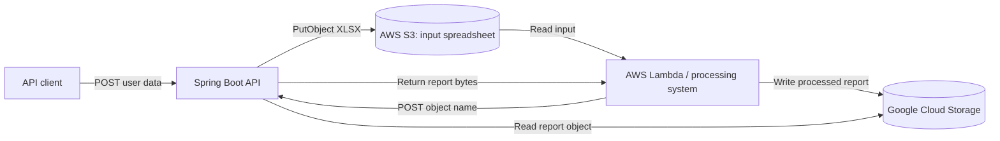
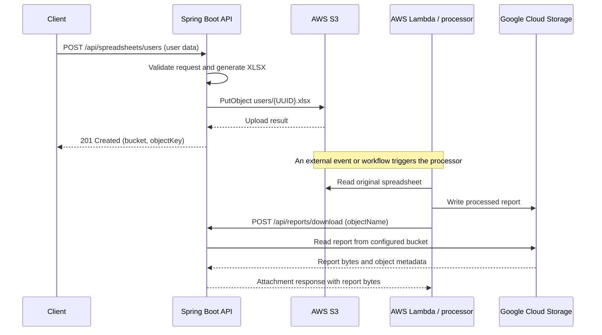

# Architecture

## Purpose and scope

This Spring Boot application provides two HTTP operations:

1. Accept basic user information, create an XLSX workbook, and upload it to AWS S3.
2. Retrieve a processed report from a configured Google Cloud Storage (GCS) bucket and return it to the caller as an HTTP attachment.

The application does **not** implement the Lambda function, spreadsheet processing, or movement of the original spreadsheet between cloud providers. The processing system is an external dependency.

## System context



The second HTTP operation is a **download callback** invoked after processing. It does not invoke Lambda itself. The Lambda (or another authorized caller) must know the GCS object name and must call this API after the report is available.

## Request sequences

### Spreadsheet creation and processing



The application does not configure an S3 event notification, Lambda trigger, callback URL, or workflow. Those integrations must be configured separately. The callback returns the report to the HTTP caller; it does not put it back into S3.

### Components

| Package / component | Responsibility |
|---|---|
| `com.example.spreadsheet` | Spring Boot application entry point |
| `config.CloudStorageConfiguration` | Creates AWS S3 and Google Cloud Storage SDK clients |
| `controller.UserSpreadsheetController` | Validates and exposes the spreadsheet creation HTTP operation |
| `controller.ReportDownloadController` | Exposes the report download operation and HTTP attachment headers |
| `service.SpreadsheetGenerator` | Maps the user list into an in-memory XLSX workbook |
| `service.UserSpreadsheetService` | Generates a unique S3 key and uploads the workbook |
| `service.GcsReportService` | Reads report bytes and metadata from the configured GCS bucket |
| `model` | HTTP request and response records |

Controllers handle HTTP concerns; services contain storage and workbook orchestration; models define the JSON contract. Cloud SDK clients are injected as Spring beans.

## API contract summary

| Method and path | Input | Success response | Cloud operation |
|---|---|---|---|
| `POST /api/spreadsheets/users` | JSON object containing non-empty `users` list | `201 Created`, JSON with S3 `bucket` and `objectKey` | S3 `PutObject` under `users/{UUID}.xlsx` |
| `POST /api/reports/download` | JSON object containing non-blank `objectName` | `200 OK`, report bytes as attachment | GCS object lookup and content read from `GCS_REPORT_BUCKET` |

The user record requires non-blank first and last names and an email-formatted address; phone is optional. For exact examples and environment setup, see the root [README](../README.md).

## Configuration and identity

`src/main/resources/application.properties` maps environment variables to Spring properties:

| Spring property | Environment variable | Notes |
|---|---|---|
| `app.aws.region` | `AWS_REGION` | Defaults to `us-east-1` |
| `app.aws.s3.bucket` | `AWS_S3_BUCKET` | Required destination for uploaded workbooks |
| `app.gcp.gcs.bucket` | `GCS_REPORT_BUCKET` | Required source for report downloads |
| `server.port` | `PORT` | Defaults to `8080` |

AWS credentials are resolved through the AWS SDK default credential provider chain. GCS credentials are resolved through Google Cloud Application Default Credentials. The deployment should supply workload identities or equivalent managed credentials; do not package long-lived keys in the application or repository.

Use least-privilege identities:

- AWS: allow object upload to the configured bucket, preferably limited to the `users/*` key prefix.
- GCP: allow reading report objects from the configured report bucket.
- Lambda/caller: allow network access to the report API and authenticate through deployment infrastructure.

## Error and data behavior

- Bean Validation rejects malformed requests with `400 Bad Request`.
- A report object that is not found produces `404 Not Found`.
- S3 or GCS SDK failures are mapped to `502 Bad Gateway`.
- S3 object names are generated by the API and returned to the caller. The original workbook uses the XLSX media type.
- Report download names derive from the final segment of `objectName`; the response content type uses GCS metadata or `application/octet-stream` when metadata is absent.
- Workbook creation, S3 upload, and GCS download currently buffer the full content in memory. This is simple for small files; enforce payload and file-size limits in deployment, and consider streaming for large objects.

## Security and operational boundaries

There is no application-level authentication or authorization configured in this project. In particular, protect `POST /api/reports/download` behind an authenticated gateway, private network, or equivalent mechanism. The endpoint accepts an object name in a fixed bucket, but access control is still required to prevent unauthorized report retrieval.

Configure transport security (TLS), request-size/time limits, cloud identity permissions, monitoring, and deployment health checks in the hosting environment. Keep cloud credentials, bucket names for production, and other environment-specific values outside source control.

## Local development and verification

The service requires valid cloud configuration and credentials to execute real storage requests. Build and run the automated tests with:

```powershell
mvn test
```

See the root [README](../README.md) for local environment variables and `mvn spring-boot:run` instructions.
