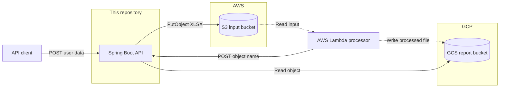
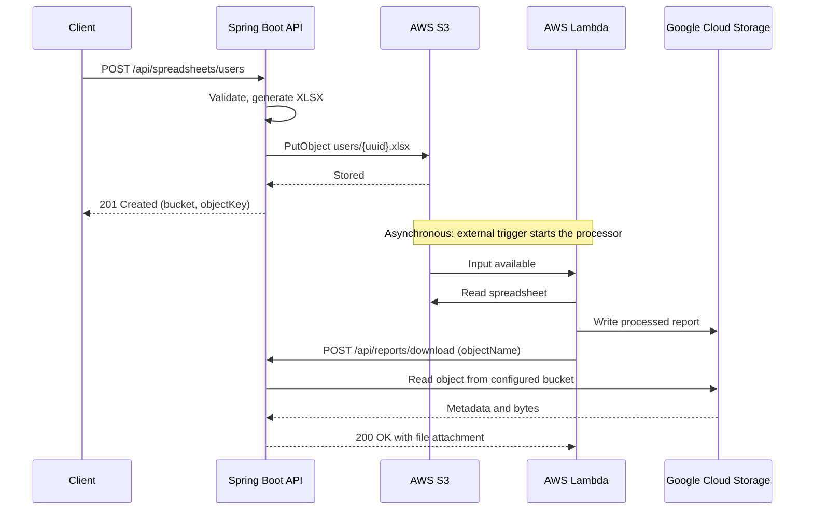
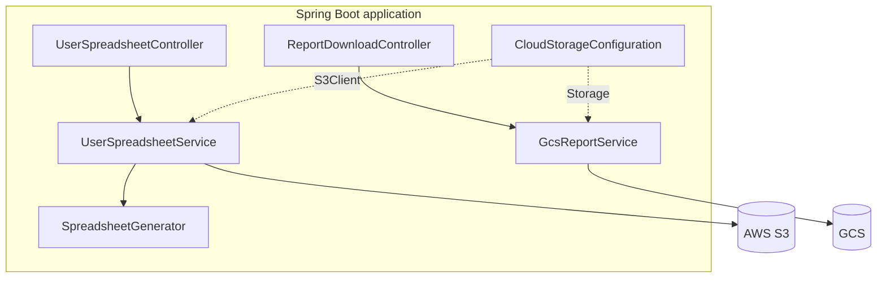

# Architecture (High-Level Design)

This document covers the system's parts, boundaries, and major decisions. For classes and step-by-step behavior, see [Design](DESIGN.md). For setup and API usage, see the [README](../README.md).

## Purpose and scope

The system moves user data through a cross-cloud pipeline: data enters through an API, is stored in AWS, is processed by AWS Lambda, lands in Google Cloud Storage (GCS), and is retrieved through the same API.

| In this repository | Outside this repository |
|---|---|
| REST endpoint that creates a spreadsheet and uploads it to S3 | The Lambda function and its processing logic |
| REST endpoint that serves a processed report from GCS | The trigger that starts Lambda |
| S3 and GCS client configuration | Creating buckets and IAM identities |
| | Authentication, TLS, and the deployment platform |

## System context

Solid arrows are behavior this repository implements or receives. Dotted arrows are the external processor's own work.

**The API never calls Lambda.** Lambda is a client of the download endpoint, and that is the only link between them. The S3 object is the handoff from the API to the processor, and the HTTP call is the handoff back.

## End-to-end flow

The two requests are independent. The client's call finishes when the upload does, and the API holds no state linking the upload to the later download. Any link between the two objects is the processor's naming choice.

## Logical components

| Layer | Responsibility |
|---|---|
| Controller | Routes, request validation, response headers |
| Service | Workbook generation, cloud calls, mapping failures to HTTP statuses |
| Model | JSON contract and validation rules |
| Config | Building the cloud clients and choosing their endpoints |

The application is stateless: it has no database or session, and every durable artifact lives in S3 or GCS. Instances can therefore be scaled horizontally and replaced freely.

## Key decisions

| Decision | Reason | Trade-off |
|---|---|---|
| Lambda calls the API, not the reverse | Processing is asynchronous, and only Lambda knows when the report is ready | Lambda needs network access to the API and must know the object name |
| Generate UUID object keys | Requests cannot collide, and no user data appears in the key | A retried request creates a duplicate object |
| Fix buckets in configuration | Callers cannot reach any other bucket | One deployment serves one bucket pair |
| `POST` for the download | The object name is validated in the body and stays out of URLs and access logs | Less conventional than `GET`, and not cacheable |
| Buffer files in memory | Simple code, and `Content-Length` is known up front | Memory use grows with file size |
| Return `502` for all cloud failures | Tells callers the fault is upstream, without leaking details | Callers cannot tell a permission error from an outage; the log can |
| Use the SDKs' default credential chains | No secrets in code or config, and workload identity works unchanged | A missing credential surfaces on the first request, not at startup |

## Deployment

The API runs as one or more stateless instances of an executable jar. It needs:

- Outbound HTTPS to S3 and to GCS
- Inbound HTTPS from clients and from Lambda
- An AWS identity and a GCP identity

If the API runs in AWS, the GCP identity should use workload identity federation instead of a downloaded service-account key.

## Security

The application has **no authentication or authorization of its own**, so the deployment must provide them. This matters most for `POST /api/reports/download`, which returns any object in the report bucket to whoever can reach it. Put the API behind an authenticated gateway or private network, and use TLS for all traffic.

Grant each identity least privilege:

| Identity | Permission | Scope |
|---|---|---|
| API, AWS | `s3:PutObject` | `arn:aws:s3:::<bucket>/users/*` |
| API, GCP | `storage.objects.get` | The report bucket |
| Lambda, AWS | `s3:GetObject` | The input bucket's `users/*` keys |
| Lambda, GCP | `storage.objects.create` | The report bucket |

Spreadsheets contain names, email addresses, and phone numbers. Enable encryption at rest and a retention policy on both buckets. The application logs bucket and object names on failure, never spreadsheet contents.

## Quality attributes

| Attribute | Current behavior | To go further |
|---|---|---|
| Scalability | Stateless, so it scales horizontally | Stream files to reduce memory per request |
| Availability | Depends on S3 and GCS; there is no fallback | Add health checks to the deployment |
| Resilience | The SDKs' default retries only | Add timeouts tuned to the deployment |
| Observability | Logged errors with full cause | Add metrics and request tracing |
| Large files | Limited by instance memory | Use presigned or signed URLs for direct transfer |
