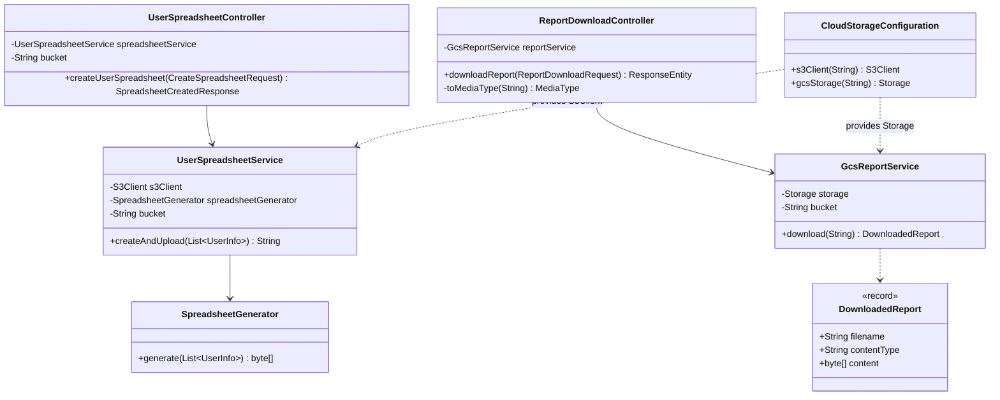
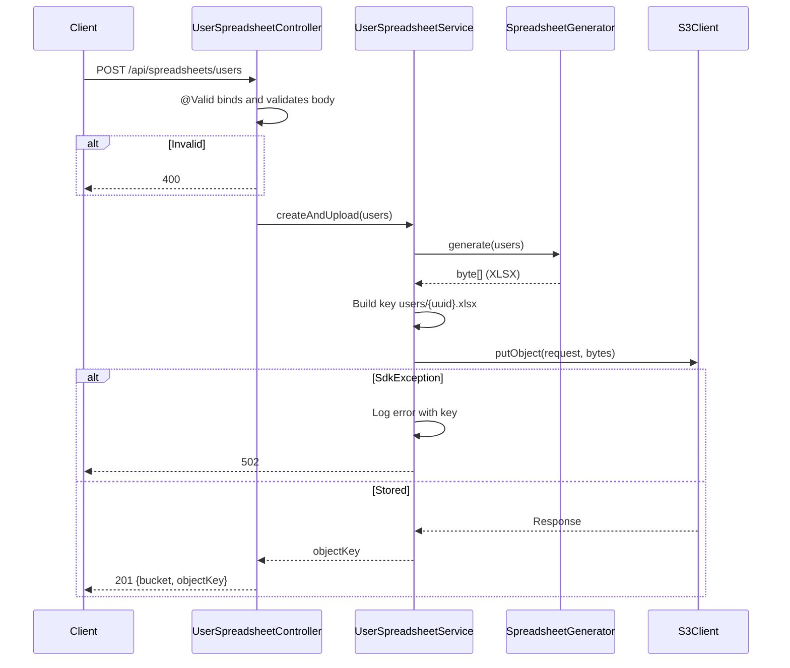
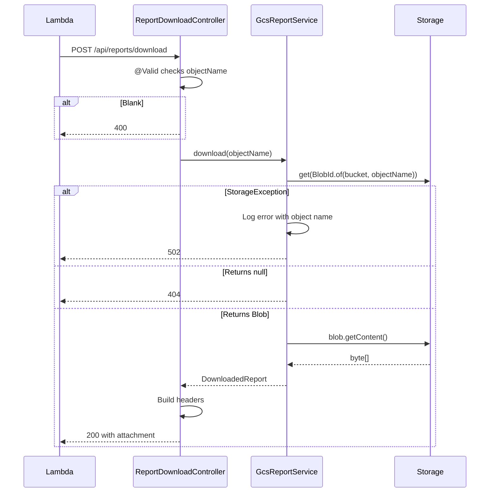

# Design (Low-Level Design)

This document explains how the code works, class by class. For system boundaries and major decisions, see [Architecture](ARCHITECTURE.md). For setup and API usage, see the [README](../README.md).

## Package layout

```text
src/main/java/com/example/spreadsheet
├── SpreadsheetApiApplication.java      Application entry point
├── config
│   └── CloudStorageConfiguration.java  Builds the S3Client and Storage beans
├── controller
│   ├── UserSpreadsheetController.java  POST /api/spreadsheets/users
│   └── ReportDownloadController.java   POST /api/reports/download
├── model
│   ├── CreateSpreadsheetRequest.java   Create request body
│   ├── UserInfo.java                   One user, one spreadsheet row
│   ├── SpreadsheetCreatedResponse.java Create response body
│   └── ReportDownloadRequest.java      Download request body
└── service
    ├── SpreadsheetGenerator.java       Users to XLSX bytes
    ├── UserSpreadsheetService.java     Generate and upload to S3
    └── GcsReportService.java           Read from GCS
```

Dependencies point one way: `controller` → `service` → cloud SDK, and `model` is shared. Controllers never touch an SDK type, and services never touch HTTP types other than `ResponseStatusException` and `HttpStatus`.

## Class diagram



All components are Spring singletons with constructor injection and no mutable state, so they are safe to share across request threads.

## Endpoint 1: create a spreadsheet



Steps in code:

1. Spring deserializes the body into `CreateSpreadsheetRequest`. `@Valid` checks the list, and `List<@Valid UserInfo>` cascades the check into each user.
2. `SpreadsheetGenerator.generate` builds the workbook in memory.
3. `UserSpreadsheetService` generates a random UUID key under `users/`.
4. `S3Client.putObject` uploads the bytes with the XLSX content type.
5. The controller adds the configured bucket name and returns `201`.

Generation runs before the key is created and before S3 is contacted, so a generation failure leaves nothing in S3.

### Workbook layout

The sheet is named `Users`. Row 0 is the header and user *N* is written to row *N + 1*.

| Column | Header | Source | When absent |
|---|---|---|---|
| A | First Name | `firstName` | Rejected by validation |
| B | Last Name | `lastName` | Rejected by validation |
| C | Email | `email` | Rejected by validation |
| D | Phone | `phone` | Empty cell |

This layout is the input contract for the Lambda processor, so a change here requires a matching change there.

Every cell is a string cell, so a value such as `=1+1` stays as literal text and is not evaluated as a formula when the file is opened.

### S3 object

| Property | Value |
|---|---|
| Bucket | `app.aws.s3.bucket` |
| Key | `users/{random UUID}.xlsx` |
| Content type | `application/vnd.openxmlformats-officedocument.spreadsheetml.sheet` |

## Endpoint 2: download a report



Steps in code:

1. `@NotBlank` rejects a missing or blank `objectName`.
2. `Storage.get` fetches metadata. It returns `null` for a missing object, which becomes `404`.
3. The filename is the text after the last `/`. A name ending in `/` has none, so `report` is used.
4. `Blob.getContent` reads the whole object into memory.
5. The controller sets `Content-Type`, `Content-Length`, and `Content-Disposition`, and returns the bytes.

### Content type resolution

GCS stores the content type as free text, so the value cannot be trusted to parse.

| Stored value | `Content-Type` returned |
|---|---|
| Valid media type | That value |
| Absent | `application/octet-stream`, set by `GcsReportService` |
| Not a valid media type | `application/octet-stream`, set by `ReportDownloadController.toMediaType` |

### Filename encoding

The controller uses `ContentDisposition.filename(name, UTF_8)`, so names are safe for any language. Spring emits two parameters: `filename*`, which is the standard form, and `filename`, which holds an RFC 2047-encoded value even for plain ASCII names:

```text
Content-Disposition: attachment; filename="=?UTF-8?Q?report.xlsx?="; filename*=UTF-8''report.xlsx
```

Callers that parse this header should read `filename*`. Lambda already knows the name it asked for, so it normally has no need to parse it.

## Data contracts

| Record | Field | Type | Rule |
|---|---|---|---|
| `CreateSpreadsheetRequest` | `users` | `List<UserInfo>` | `@NotEmpty`; each element `@Valid` |
| `UserInfo` | `firstName` | `String` | `@NotBlank` |
| | `lastName` | `String` | `@NotBlank` |
| | `email` | `String` | `@NotBlank`, `@Email` |
| | `phone` | `String` | Optional |
| `SpreadsheetCreatedResponse` | `bucket` | `String` | Output |
| | `objectKey` | `String` | Output |
| `ReportDownloadRequest` | `objectName` | `String` | `@NotBlank` |

## Error handling

There is no `@ControllerAdvice`. Services throw `ResponseStatusException`, and Spring turns it into the status below. Spring's defaults handle the rest.

| Trigger | Raised by | Status | Logged |
|---|---|---|---|
| Malformed JSON | Spring (`HttpMessageNotReadableException`) | 400 | WARN by Spring |
| Validation failure | Spring (`MethodArgumentNotValidException`) | 400 | WARN by Spring |
| Report not found | `GcsReportService` | 404 | No |
| `SdkException` from S3 | `UserSpreadsheetService` | 502 | ERROR with cause |
| `StorageException` from GCS | `GcsReportService` | 502 | ERROR with cause |
| Workbook cannot be serialized | `SpreadsheetGenerator` (`IllegalStateException`) | 500 | ERROR by Spring |

`SdkException` also covers client-side failures such as a refused connection or a missing credential. A `403` from GCS is a `StorageException`, so it also becomes `502`.

The two `log.error` calls matter because the HTTP response omits the cause. Without them, a `502` leaves no trace of why it happened.

## Configuration

`application.properties` maps environment variables to the properties read through `@Value`:

| Property | Environment variable | Read by |
|---|---|---|
| `app.aws.region` | `AWS_REGION` | `CloudStorageConfiguration` |
| `app.aws.s3.bucket` | `AWS_S3_BUCKET` | `UserSpreadsheetController`, `UserSpreadsheetService` |
| `app.gcp.gcs.bucket` | `GCS_REPORT_BUCKET` | `GcsReportService` |
| `app.gcp.gcs.endpoint` | `GCS_ENDPOINT` | `CloudStorageConfiguration` |
| `server.port` | `PORT` | Spring Boot |

`AWS_S3_BUCKET` and `GCS_REPORT_BUCKET` have no default, so a missing value stops the application at startup.

### Cloud client selection

| Client | Default target | Credentials | Local override |
|---|---|---|---|
| `S3Client` | Regional S3 endpoint | AWS default chain | `AWS_ENDPOINT_URL_S3`, read by the SDK itself |
| `Storage` | `storage.googleapis.com` | Application Default Credentials | `GCS_ENDPOINT`, read by `gcsStorage` |

`gcsStorage` has two branches:

```java
if (endpoint.isBlank()) {
    return StorageOptions.getDefaultInstance().getService();  // Google Cloud with ADC
}
return StorageOptions.newBuilder()                            // Emulator
        .setHost(endpoint)
        .setProjectId("local-emulator")
        .setCredentials(NoCredentials.getInstance())
        .build()
        .getService();
```

`GCS_ENDPOINT` exists because this client version ignored `STORAGE_EMULATOR_HOST`: in testing, requests went to `storage.googleapis.com` even with that variable set. The emulator branch uses `NoCredentials` so that real tokens can never be sent to a local endpoint.

## Testing

| Test class | Scope | Covers |
|---|---|---|
| `SpreadsheetGeneratorTest` | Unit | Workbook contents, formula-like input stays text, missing phone |
| `UserSpreadsheetServiceTest` | Unit, mocked `S3Client` | Bucket, key format, content type, unique keys, failure to `502` |
| `GcsReportServiceTest` | Unit, mocked `Storage` | Configured bucket, metadata, fallbacks, `404`, `502` |
| `UserSpreadsheetControllerTest` | `@WebMvcTest` | `201` body, validation, error status passthrough |
| `ReportDownloadControllerTest` | `@WebMvcTest` | Headers and body, invalid content type, validation, error status passthrough |
| `SpreadsheetApiApplicationTests` | `@SpringBootTest` | Full context with real SDK clients |

The emulator setup in the [README](../README.md#run-locally-without-cloud-accounts) adds a manual end-to-end check. It is not part of `mvn test`. Mocks and emulators do not prove behavior against real S3 or GCS, including IAM permissions.

## Known limitations

| Limitation | Effect | Possible change |
|---|---|---|
| No authentication | Anyone who can reach the API can read any report | Add Spring Security, or enforce at a gateway |
| Whole files in memory | Large files or concurrent requests can exhaust the heap | Stream, or issue signed URLs |
| No maximum on `users` | A large request can consume memory | Add `@Size(max = ...)` to `users` |
| Any object in the bucket can be named | A caller can read objects beyond its own reports | Restrict names to a prefix such as `processed/` |
| Create is not idempotent | Retrying leaves duplicate objects in S3 | Accept a client-supplied idempotency key |
| No API-level timeouts or retries | Behavior follows SDK defaults | Configure them on the client builders |
